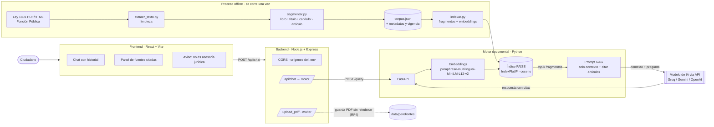

# Arquitectura propuesta – Chatbot RAG Ley 1801 de 2016

## Diagrama

## Componentes

| Capa | Tecnología | Responsabilidad |
|---|---|---|
| Corpus | PyMuPDF, regex | Extraer y limpiar la ley, segmentarla por jerarquía y guardar `corpus.json` con metadatos (ubicación, epígrafe, vigencia, temas). |
| Embeddings | sentence-transformers `paraphrase-multilingual-MiniLM-L12-v2` | Convertir cada fragmento y cada pregunta en un vector de 384 dimensiones. |
| Índice | FAISS `IndexFlatIP` | Búsqueda exacta por similitud coseno de los k fragmentos más cercanos. |
| Generación | LLM por API compatible con OpenAI | Redactar la respuesta usando solo los fragmentos recuperados y citando artículos. |
| Motor API | FastAPI | Endpoints `/query` (RAG completo), `/buscar` (solo recuperación) y `/health`. |
| Backend | Node.js + Express | API pública: CORS, `/api/chat`, `/upload_pdf/`, manejo de errores y `.env`. |
| Frontend | React + Vite | Chat, historial, fuentes verificables y aviso legal. |

## Flujo de una consulta

1. El ciudadano escribe la pregunta en el chat.
2. El frontend la envía a `POST /api/chat` del backend.
3. El backend valida la entrada y la reenvía a `POST /query` del motor.
4. El motor genera el embedding de la pregunta con el mismo modelo usado para indexar.
5. FAISS devuelve los k fragmentos más parecidos (por defecto k = 5).
6. Se arma el prompt: instrucciones + fragmentos numerados con su referencia y vigencia + pregunta.
7. El LLM responde citando los artículos, o dice que la información no está en el Código.
8. La respuesta y las fuentes vuelven al frontend, que muestra ambas.

## Decisiones de diseño

**Modelo de embeddings.** Elegimos `paraphrase-multilingual-MiniLM-L12-v2` porque está entrenado para similitud semántica en más de 50 idiomas, incluido el español, corre localmente sin costo y genera vectores pequeños (384 dimensiones) que hacen la búsqueda rápida. Su límite es de 128 tokens por texto, por eso el corpus no se indexa por artículo completo sino en fragmentos más cortos.

**Segmentación (dos estrategias a comparar).**
- *Estructural*: un fragmento por inciso, por numeral y por parágrafo. A cada numeral se le antepone el número de artículo, el epígrafe y el inicio del inciso para que no pierda el contexto.
- *Fija*: ventanas de 120 palabras con 30 de solapamiento, sin cruzar artículos.

Las dos se construyen con `python src/indexar.py --estrategia todas` y se comparan en la fase de evaluación con Precisión@k, Recall@k y MRR.

**Índice FAISS.** Con unos cientos o pocos miles de fragmentos, `IndexFlatIP` hace búsqueda exacta en milisegundos, así que no hace falta un índice aproximado (IVF o HNSW). Los vectores se normalizan, con lo que el producto interno equivale a la similitud coseno.

**Modelo de IA.** El motor usa el cliente de OpenAI con `LLM_BASE_URL` configurable, así el mismo código funciona con Groq, Gemini u OpenAI cambiando solo el `.env`. La temperatura es 0.1 para reducir respuestas creativas.

**Control de alucinaciones.** El prompt obliga a responder solo con el contexto, citar artículo, numeral o parágrafo, advertir la vigencia y responder con una frase fija cuando la información no está en el Código (RF2, RF3).

**Seguridad.** Las claves viven en `.env`, que no se sube al repositorio (RNF2). El backend solo acepta los orígenes configurados en CORS (RNF3) y el endpoint de carga solo acepta PDF de hasta 20 MB.

## Próximos pasos

- Búsqueda híbrida: combinar FAISS con BM25 (`rank-bm25`) y el glosario de sinónimos coloquiales.
- Clasificador temático para filtrar por libro o título antes de buscar.
- Frontend en React con panel de fuentes.
- Banco de 50 preguntas y evaluación con métricas.
